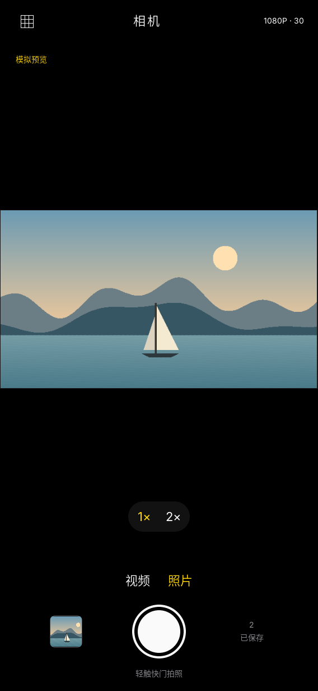
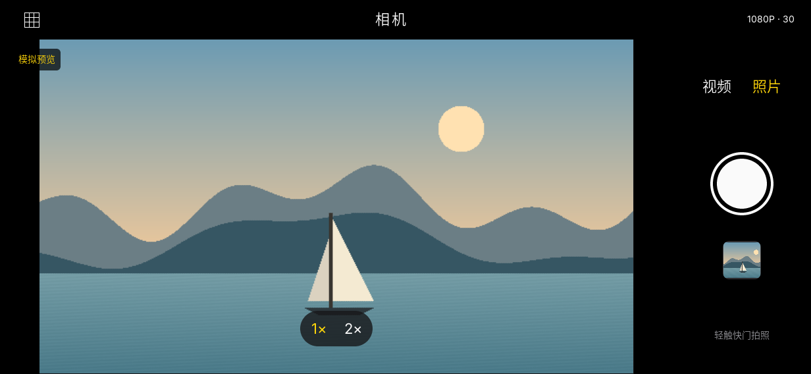
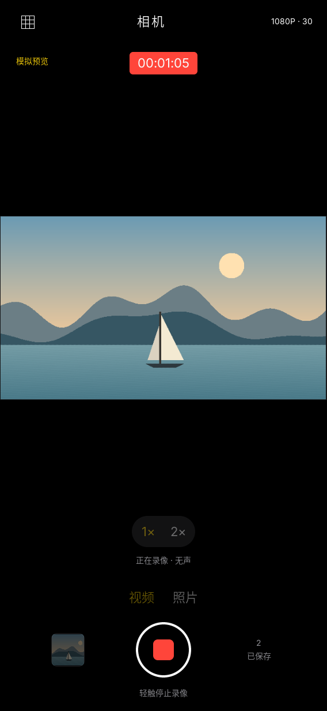

# LILYGO Camera

**English** | [简体中文](README.zh-CN.md)

LILYGO Camera is a local camera app for T-DisplayCM0 and T-Display-K230. It is
built with C++17, [LILYGO UI AppKit](https://github.com/LILYGO-UI/cm0-appkit),
LVGL, and the platform camera backend. The interface supports portrait and
landscape layouts and saves photos and videos on the device.

The project includes an SDL2 desktop simulator for development and testing, and
an AArch64 Linux package for CM0 devices.

## Preview

<p>
  
  
  
</p>

## Features

- **Photo and video:** capture JPEG photos and silent H.264/MP4 video.
- **Capture profiles:** choose `720P · 30` (default), `1080P · 30`, or
  `720P · 60`. Photos and videos share the selected profile.
- **Camera controls:** switch photo/video mode, show a recording timer, enable a
  composition grid, and choose 1× or 2× digital crop. The crop applies to both
  the viewfinder and saved media; it is not optical zoom.
- **Recent capture:** show a low-resolution viewfinder thumbnail of the latest
  capture from the current app session. It is not a photo viewer or gallery;
  video playback is not provided.
- **Responsive layout:** rearrange controls for portrait and landscape screens.
- **Desktop simulator:** display a clearly marked synthetic viewfinder and save
  valid JPEG and MP4 files through FFmpeg. The simulator does not open the
  development computer's camera.

The app does not currently provide camera switching, flash, portrait effects,
audio recording, or video playback. Autofocus is enabled only when the camera
stack exposes the required `AfMode` control; the presence of an FP5510 lens motor
alone does not guarantee autofocus support.

## Hardware and Camera Orientation

The target T-DisplayCM0 camera setup is defined by its device-tree overlay:

| Component | Configuration |
| --- | --- |
| Image sensor | Sony IMX219, I2C0 address `0x1a` |
| Camera interface | CSI1, 2 lanes, 24 MHz clock |
| Sensor orientation | Device-tree rotation `180`, orientation `2` |
| Lens motor | FP5510, I2C0 address `0x0c`, associated as `lens-focus` |
| Display | `568×1232` portrait; `1232×568` landscape |

The app uses libcamera and does not access sensor registers or modify the device
tree. libcamera applies the sensor's installed orientation. The camera is also
mounted 90° counter-clockwise relative to the portrait display; the app combines
that fixed offset with the screen orientation for the viewfinder and saved
media. As a result, portrait preview is `360×640`; default saved media is
`720×1280` for 720p and `1080×1920` for 1080p. Landscape media uses the
corresponding `1280×720` or `1920×1080` dimensions. The synthetic SDL image does
not use the physical mounting offset.

The profiles describe requested capture and encoding settings, not guaranteed
hardware performance. In particular, whether `720P · 60` is achievable depends
on the image, sensor mode, camera pipeline, and encoder. Verify actual capture
frame rates and output on the target device.

T-Display-K230 uses a different camera stack:

| Component | Configuration |
| --- | --- |
| Image sensor | GalaxyCore GC2093, I2C0 address `0x37` |
| Camera interface | CSI2/MIPI0 through the BSP VVCAM pipeline |
| Capture node | VVCAM SP2 (`vvcam-video.*.2`) preferred; other NV16/NV12 capture nodes are fallbacks (override with `CAMERA_K230_DEVICE`) |
| Pixel format | NV16 (NV12 fallback) |
| Sensor capture | Fixed `1920×1080`; preview and 720P media are sampled in software |
| ISP startup | `/usr/bin/isp_media_server` with `ISP_MEDIA_SENSOR_DRIVER=/usr/lib/libvvcam.so` |

The K230 backend starts or reuses `isp_media_server`, scans the V4L2 nodes for a
capture device that exposes NV16 or NV12, preferring the SP2 scaling output by
its sysfs name, and converts those frames to the app's
BGR preview format. It does not
use libcamera or the CM0 IMX219 path. Stop the board's RTSP stream before
opening Camera because both paths use the same ISP pipeline. See the
[official T-Display-K230 repository](https://github.com/Xinyuan-LilyGO/T-Display-K230)
for the board and driver setup. The v0.2.9 BSP can produce displaced rows and
chroma when switching from 1080P back to 720P, including on SP2. K230 therefore
keeps native 1080P capture and the same capture queue running across profile
changes. Only software output dimensions and encoding cadence change; ordinary
preview converts only its sampled pixels. The requested 60 fps profile does
not configure or guarantee 60 distinct sensor frames per second. Do not query
an active capture node with another process: this BSP can destroy the shared
pipeline when that process closes its device handle. A running ISP
service is reused and is never killed by the application. Debian images with
`CONFIG_RT_GROUP_SCHED` and cgroup v2 need the ISP thread compatibility library
installed by canaan-gen when `BSP_CAMERA_RUNTIME=1`.

## Development Environment

Run project commands from the repository root. Project identity, version, and
package metadata are defined in [`lpm.toml`](lpm.toml); the
[`CMakePresets.json`](CMakePresets.json) file defines `host-simulator` and
`cm0-cross` builds.

### Get the Source

```sh
git clone --recurse-submodules https://github.com/LILYGO-UI/camera.git
cd camera
```

For an existing checkout, initialize the pinned AppKit dependency:

```sh
git submodule update --init --recursive
```

The project builds against AppKit in `third_party/cm0-appkit`; a separate AppKit
installation is not needed for the simulator.

### Host Dependencies

For the desktop simulator, install CMake 3.21 or later, a C/C++17 compiler,
Git, `pkg-config`, SDL2, FreeType, FFmpeg, Python 3.11 or later, and LPM.
FFmpeg is required to generate simulated capture files. Device builds also need
an AArch64 Linux cross compiler.

#### Debian 12 / Ubuntu 24.04 or Later

```sh
sudo apt update
sudo apt install build-essential cmake git pkg-config patch libsdl2-dev \
  libfreetype6-dev ffmpeg ca-certificates python3 python3-venv python3-pip
```

On older distributions, install versions that meet the minimum CMake and Python
requirements above.

#### macOS

Install the Xcode Command Line Tools if needed, then use Homebrew:

```sh
xcode-select --install
brew install git cmake pkg-config patch sdl2 freetype ffmpeg python
```

Make sure Homebrew and its installed tools are available on `PATH`.

#### LPM

CMake reads project metadata by running `lpm metadata --format cmake`. If LPM is
not already installed, create a project-local Python environment and install
it:

```sh
python3 -m venv .venv
. .venv/bin/activate
python -m pip install "git+https://github.com/LILYGO-UI/lpm.git"
lpm --version
```

Activate `.venv` in each new terminal before running `lpm`. CMake also accepts
an existing LPM executable through `-DLPM_EXECUTABLE=/absolute/path/to/lpm`.

### Device Cross Compiler

Skip this step when building only the desktop simulator.

**Debian / Ubuntu:**

```sh
sudo apt install gcc-aarch64-linux-gnu g++-aarch64-linux-gnu
```

**Apple Silicon macOS:**

```sh
brew install aarch64-unknown-linux-gnu
```

The CM0 toolchain expects `aarch64-linux-gnu-gcc` and
`aarch64-linux-gnu-g++` on `PATH`. The build prepares the target sysroot; it does
not install the host cross compiler.

## Build and Test

### Desktop Simulator

Build and launch the app in a graphical desktop session:

```sh
lpm start --foreground
```

To launch an existing build without rebuilding, use
`lpm start --no-build --foreground`. Or build and run the commands separately:

```sh
cmake --preset host-simulator
cmake --build --preset host-simulator --parallel
ctest --preset host-simulator
lpm start --no-build --foreground
```

To choose a capture directory and test portrait rendering directly:

```sh
CAMERA_SIMULATE=1 CAMERA_OUTPUT_DIR="$PWD/build/captures" \
  ./build/host-simulator/lilygo-ui-camera --display sdl \
  --width 568 --height 1232 --orientation portrait
```

Use `--orientation landscape` to try the landscape layout. The simulator writes
captures to disk and keeps them after the app closes. Simulated filenames have
the `SIM_IMG_` or `SIM_VID_` prefix.

### Tests

Run the host test suite with:

```sh
lpm test
```

The suite covers camera state and error handling, frame transforms, ViewModel
bindings, simulated capture and media handling, and portrait/landscape UI
rendering. Render outputs are written under `build/host-simulator/`, including
`camera-portrait.ppm` and `camera-landscape.ppm`. Host tests do not verify
physical camera orientation, sensor frame rate, or target-device encoding
performance.

### CM0 Device Build and Installation

Build the AArch64 Debian package:

```sh
lpm pack
```

The `cm0-cross` preset automatically prepares a complete ARM64 development
sysroot from the package versions and SHA-256 hashes in
`cmake/cm0-sysroot-packages.json`. It includes the matching
`0.8.0+rpt20261104-1` libcamera headers, runtime libraries, IPA and Debian
symbols/ownership metadata used by CPack. Downloads and the extracted sysroot
are cached under `.cache/cm0-sysroot/`; subsequent builds reuse them offline.
The old BSP `0.1.0` is no longer needed for this application.

The host needs Python 3.9+, `curl`, `dpkg-deb` and `dpkg-shlibdeps`, in addition
to CMake and the AArch64 compiler. On macOS, `brew install dpkg` provides both
Debian tools. Existing builds automatically discard paths and pkg-config
results cached from the old BSP. No `LIBCAMERA_DEV_ROOT` argument is needed.

For a custom or pre-provisioned sysroot, configure with
`-DCM0_SYSROOT=/path/to/sysroot`. It must include target headers, libraries and
`var/lib/dpkg/{status,info}` metadata. If it uses a different libcamera version,
set both `LIBCAMERA_DEBIAN_PACKAGE` and `LIBCAMERA_PINNED_VERSION` to match.
`LIBCAMERA_DEV_ROOT` remains available for an explicit development prefix;
its libraries must also be present in the packaging sysroot. Clear old
explicit overrides with `cmake --fresh --preset cm0-cross` (CMake 3.24+) when
returning to the automatic configuration.

The sysroot preparation regression tests run without network access:

```sh
python3 -m unittest discover -s tests -p test_cm0_sysroot.py
```

On an ARM64 Raspberry Pi OS trixie build host with the Raspberry Pi and LILYGO
APT repositories configured, the package can also be built against the native
development libraries, without cross-compiling:

```sh
sudo apt update
sudo apt install build-essential cmake pkg-config libdrm-dev libfreetype6-dev \
  libcamera-dev=0.8.0+rpt20261104-1 libcamera0.8=0.8.0+rpt20261104-1 \
  libcamera-ipa=0.8.0+rpt20261104-1
cmake -S . -B build/cm0-native \
  -DLilyGoUI_DIR="$PWD/third_party/cm0-appkit" \
  -DCM0_SIMULATOR=OFF -DBUILD_TESTING=OFF \
  -DCMAKE_BUILD_TYPE=Release -DCMAKE_INSTALL_PREFIX=/usr
cmake --build build/cm0-native --parallel
cpack --config build/cm0-native/CPackConfig.cmake -B dist
```

This requires `lpm` and the initialized AppKit submodule, as above.

K230 builds use the BSP camera path directly: the application starts
`isp_media_server` with `ISP_MEDIA_SENSOR_DRIVER=/usr/lib/libvvcam.so`, then
scans `/dev/video*` for a V4L2 capture node. NV16 is preferred and NV12 is
accepted as a fallback. K230 builds therefore do not require libcamera headers
or runtime packages. The camera service must expose the GC2093 node and the
application user must have access to the selected video node; set
`CAMERA_K230_DEVICE` when a fixed node is required.

The package is written to `dist/lilygo-ui-camera_0.1.4_arm64.deb`. It depends on
`lilygo-ui-appkit-dev >= 0.1.0` for the shared runtime fonts as well as the
camera and media libraries. Make sure the AppKit package is available from the
device's configured package sources. On the CM0 Raspberry Pi OS image, install
the runtime dependencies and package:

```sh
sudo apt update
sudo apt install ./lilygo-ui-camera_0.1.4_arm64.deb
```

Version `0.1.4` requires `libcamera0.8` and `libcamera-ipa` at
`0.8.0+rpt20261104-1`; APT installs these dependencies together. The binary must
be rebuilt for this ABI: changing only the dependency names of an older DEB
does not make its libcamera 0.7 binary compatible. Publish the new ARM64 package
to the signed LILYGO APT repository before restarting pi-gen; its stage2 and
stage5 installers already refresh the repository metadata.

Launch **Camera** from the app launcher. To run it directly, the user needs
camera, DRM, and input-device access, and no other process may own the camera
or DRM display:

```sh
CAMERA_SIMULATE=0 /usr/bin/lilygo-ui-camera --display drm \
  --drm /dev/dri/card0 --orientation portrait
```

Use `--drm`, `--drm-connector`, or `--input` to override device nodes. A system
with a framebuffer can instead use `--display fbdev --fbdev /dev/fb0`.

## Capture Location and Configuration

Captures are saved to `$HOME/Camera` by default. Set `CAMERA_OUTPUT_DIR` to
choose another writable directory. Files remain on disk after the app exits;
the recent-capture thumbnail is kept only in memory for the current session.
The app does not use network services or record audio.

Each launch starts at `720P · 30`. Tap the profile control at the top of the
viewfinder to cycle through these profiles:

| Profile | Requested capture / saved size before rotation | Target frame rate |
| --- | --- | --- |
| `720P · 30` (default) | `1280×720` | 30 fps |
| `1080P · 30` | `1920×1080` | 30 fps |
| `720P · 60` | `1280×720` | 60 fps |

Changing profiles reconfigures the camera and may fail if the device does not
support the requested mode. The app reports the failure and attempts to restore
the previous profile. The selection lasts for the current session only. A
60-fps MP4 setting does not by itself prove that the sensor supplied 60 unique
frames per second.

| Environment variable | Purpose |
| --- | --- |
| `CAMERA_SIMULATE=1` | Use the synthetic viewfinder and simulated capture backend. |
| `CAMERA_SIMULATE=0` | Use the real platform backend; this is the device-build default. |
| `CAMERA_K230_DEVICE` | Override the K230 V4L2 node. If unset, the backend scans `/dev/video*` and prefers the VVCAM SP2 output by its sysfs name, then tries other NV16/NV12 capture nodes. |
| `CAMERA_OUTPUT_DIR` | Override the capture directory. |
| `CAMERA_FFMPEG` | Set the FFmpeg executable path; by default it is searched on `PATH`. |
| `CAMERA_VIDEO_CODEC` | Select `auto` (default), `hardware`, or `software` H.264 encoding. |
| `CAMERA_TRACE=1` | Log capture and frame-processing rates and transform time to standard error every two seconds. |

On supported CM0 images, `auto` prefers the `h264_v4l2m2m` hardware encoder
when available and otherwise uses `libx264`. The app writes video in the
background and confirms the output before reporting a successful save.

## Troubleshooting

| Symptom | Check |
| --- | --- |
| `lpm is required to read project metadata` | Activate `.venv`, install LPM, or set `LPM_EXECUTABLE`. |
| AppKit or LVGL sources are missing | Run `git submodule update --init --recursive`. |
| SDL2 or FreeType is not found | Install the host development packages; on macOS, check Homebrew paths. |
| CM0 development files cannot be downloaded/found | Check network access, disk space, Python, curl and dpkg; or set `CM0_SYSROOT` to a complete ARM64 development sysroot with Debian metadata. |
| IMX219 is not detected | On CM0, check the camera cable, board overlay, I2C0 pin setup, and kernel camera probe logs. |
| K230 camera pipeline is unavailable | Stop RTSP, confirm `isp_media_server` and `/usr/lib/libvvcam.so`, inspect `/tmp/isp.err.log`, and use `v4l2-ctl --list-devices`/`--list-formats-ext` to find a selected node exposing NV16 or NV12. |
| Camera is detected but no preview appears | Check that another process is not using the camera and that the platform camera runtime matches the board image. |
| Capture or video save fails | Check `ffmpeg -version`, output-directory permissions, free disk space, and `CAMERA_FFMPEG`. |

Some images provide `rpicam-hello` instead of `libcamera-hello` for camera
diagnostics. These utilities are optional; the app uses the libcamera library
directly. The board overlay requires the documented `i2c0,pins_44_45` setup;
follow the T-DisplayCM0 image instructions and avoid enabling a conflicting
IMX219 overlay.

## Documentation

| Guide | Contents |
| --- | --- |
| [Project overview](docs/00-overview.md) (Chinese) | Feature scope, architecture, dependencies, build and hardware acceptance. |
| [UI guidelines](docs/01-user-interface.md) (Chinese) | Layout, typography, component ownership, and UI validation. |

## Acknowledgments

This app uses [LILYGO UI AppKit](https://github.com/LILYGO-UI/cm0-appkit),
[LVGL](https://lvgl.io/), the CM0 [libcamera](https://libcamera.org/) backend,
the K230 V4L2/VVCAM backend, and [FFmpeg](https://ffmpeg.org/). The project
package metadata declares the MIT license.

## K230 Debian packages

Install `gcc-riscv64-linux-gnu` and `g++-riscv64-linux-gnu` on Linux, or LLVM, LLD and dpkg on macOS (`brew install llvm lld dpkg`). From this application's repository, run the packaging command.

```sh
lpm pack --arch riscv64
```

The `k230-debian` CMake preset downloads the pinned Debian BSP from the `LILYGO-UI/canaan-gen` release and verifies its SHA-256. It keeps the archive and `sysroot/` in this project's `.cache/k230-bsp/20261116T104343Z/`. The next build reuses the cache offline, even with a new `build/` directory. Packages appear in `dist/`.

Run `lpm set-target k230` once to use `lpm pack` for subsequent builds. To use your own Debian sysroot, set `LILYGO_UI_DEBIAN_SYSROOT` before the first configure, or pass `-DLILYGO_UI_DEBIAN_SYSROOT=/path/to/sysroot` to CMake. The pinned `third_party/cm0-appkit` supplies the application SDK. `-DLilyGoUI_DIR=/path/to/appkit` selects another copy.
