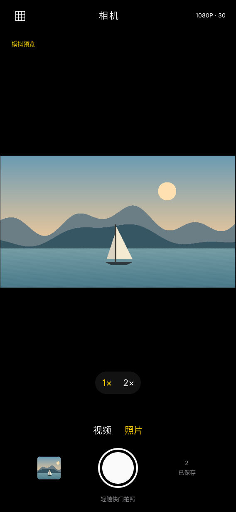
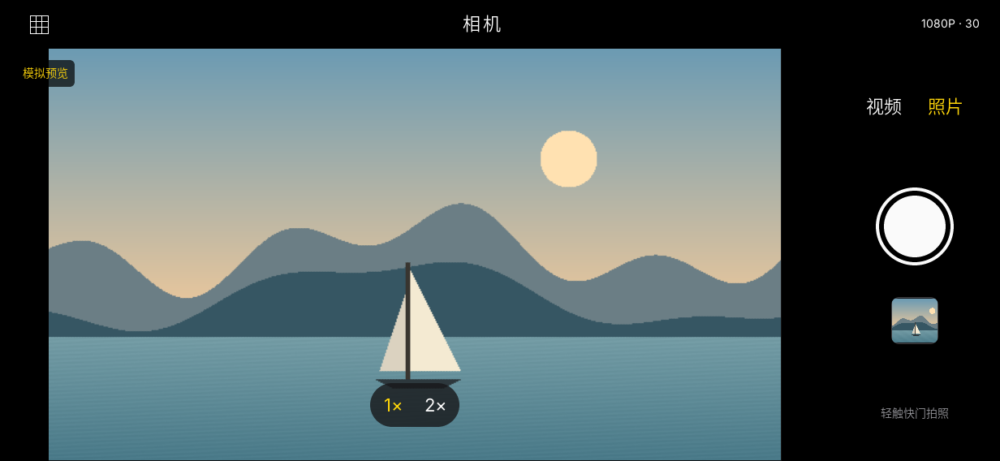
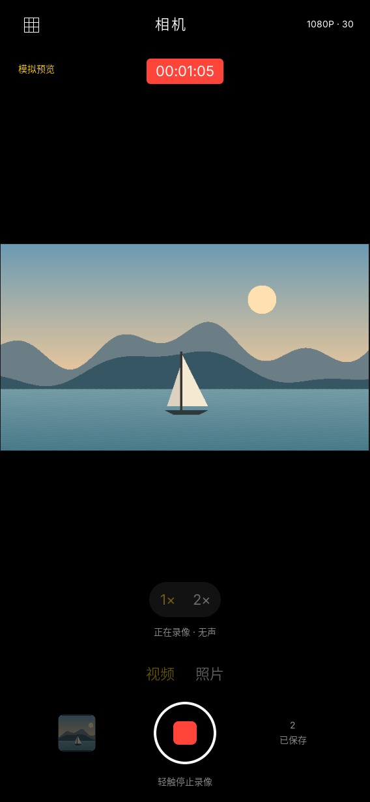

# LILYGO 相机

[English](README.md) | **简体中文**

LILYGO 相机是一款面向 T-DisplayCM0 及其 Sony IMX219 摄像头的本地相机应用，使用
C++17、[LILYGO UI AppKit](https://github.com/LILYGO-UI/cm0-appkit)、LVGL 和
libcamera C++ API 构建。界面支持竖屏和横屏，并将照片与视频保存在设备本地。

项目提供用于开发和测试的 SDL2 桌面模拟器，以及面向 CM0 设备的 AArch64 Linux 安装包。

## 预览

<p>
  
  
  
</p>

## 功能

- **拍照与录像：** 拍摄 JPEG 照片和无声 H.264/MP4 视频。
- **采集规格：** 可选择 `720P · 30`（默认）、`1080P · 30` 或 `720P · 60`。照片和视频共用当前规格。
- **相机控件：** 切换拍照/录像模式、显示录像计时、开启构图网格，并选择 1× 或 2× 数字裁切。裁切同时应用于取景和保存媒体，不是光学变焦。
- **最近拍摄：** 显示本次应用运行期间最后一次拍摄的低分辨率取景缩略图。它不是照片查看器或相册，应用内暂不支持视频播放。
- **响应式布局：** 根据竖屏或横屏重新排列控件。
- **桌面模拟器：** 显示明确标记的模拟取景，并通过 FFmpeg 保存有效的 JPEG 和 MP4 文件。模拟器不会打开开发电脑的摄像头。

当前版本不提供镜头切换、闪光灯、人像效果、录音或视频播放。只有摄像头软件栈提供
`AfMode` 控制时才会启用自动对焦；存在 FP5510 镜头马达本身并不代表系统支持自动对焦。

## 硬件与摄像头方向

目标 T-DisplayCM0 相机配置由设备树 overlay 定义：

| 部件 | 配置 |
| --- | --- |
| 图像传感器 | Sony IMX219，I2C0 地址 `0x1a` |
| 摄像头接口 | CSI1，2 lanes，24 MHz 时钟 |
| 传感器方向 | 设备树旋转 `180`，orientation `2` |
| 镜头马达 | FP5510，I2C0 地址 `0x0c`，关联为 `lens-focus` |
| 显示屏 | 竖屏 `568×1232`；横屏 `1232×568` |

应用通过 libcamera 工作，不直接访问传感器寄存器，也不修改设备树。传感器安装方向由
libcamera 处理。相机相对竖屏面板还安装了逆时针 90°；应用会把该固定偏角与屏幕方向合并，
统一处理取景和保存媒体。因此竖屏预览为 `360×640`；720p 媒体保存为 `720×1280`，
1080p 媒体保存为 `1080×1920`。横屏保存尺寸分别为 `1280×720` 或 `1920×1080`。
SDL 模拟图案不应用物理安装偏角。

规格表示请求的采集和编码设置，不代表硬件一定能达到目标性能。尤其是 `720P · 60`，
其可用性取决于 CM0 镜像、传感器模式、libcamera 管线和编码器。请在目标设备上验证实际采集帧率和输出。

## 开发环境搭建

所有项目命令均在仓库根目录执行。项目标识、版本和软件包元数据定义在
[`lpm.toml`](lpm.toml)；[`CMakePresets.json`](CMakePresets.json) 定义了
`host-simulator` 和 `cm0-cross` 构建。

### 获取源码

```sh
git clone --recurse-submodules https://github.com/LILYGO-UI/camera.git
cd camera
```

已有仓库可初始化锁定版本的 AppKit 依赖：

```sh
git submodule update --init --recursive
```

项目直接使用 `third_party/cm0-appkit` 中的 AppKit，构建桌面模拟器无需单独安装 AppKit。

### 主机依赖

构建桌面模拟器需要 CMake 3.21 或更高版本、支持 C++17 的 C/C++ 编译器、Git、
`pkg-config`、SDL2、FreeType、FFmpeg、Python 3.11 或更高版本以及 LPM。
模拟拍摄需要 FFmpeg 生成媒体文件。设备构建还需要 AArch64 Linux 交叉编译器。

#### Debian 12 / Ubuntu 24.04 或更高版本

```sh
sudo apt update
sudo apt install build-essential cmake git pkg-config patch libsdl2-dev \
  libfreetype6-dev ffmpeg ca-certificates python3 python3-venv python3-pip
```

较旧发行版请安装满足上述 CMake 和 Python 最低版本要求的软件包。

#### macOS

如尚未安装，请先安装 Xcode Command Line Tools，再使用 Homebrew 安装依赖：

```sh
xcode-select --install
brew install git cmake pkg-config patch sdl2 freetype ffmpeg python
```

请确保 Homebrew 和其安装的工具已加入 `PATH`。

#### LPM

CMake 通过执行 `lpm metadata --format cmake` 读取项目元数据。如尚未安装 LPM，
可在项目虚拟环境中安装：

```sh
python3 -m venv .venv
. .venv/bin/activate
python -m pip install "git+https://github.com/LILYGO-UI/lpm.git"
lpm --version
```

每次打开新终端后，运行 `lpm` 前先激活 `.venv`。也可在 CMake 配置时通过
`-DLPM_EXECUTABLE=/absolute/path/to/lpm` 指定已有的 LPM 可执行文件。

### 设备交叉编译器

如果只构建桌面模拟器，可跳过此步骤。

**Debian / Ubuntu：**

```sh
sudo apt install gcc-aarch64-linux-gnu g++-aarch64-linux-gnu
```

**Apple Silicon macOS：**

```sh
brew install aarch64-unknown-linux-gnu
```

BSP 工具链要求 `aarch64-linux-gnu-gcc` 和 `aarch64-linux-gnu-g++` 位于 `PATH` 中。
BSP 提供目标平台 sysroot，但不会安装开发机所需的交叉编译器。

## 构建与测试

### 桌面模拟器

在图形桌面会话中构建并启动应用：

```sh
lpm start --foreground
```

如需复用已有构建产物，运行 `lpm start --no-build --foreground`。也可以分步执行：

```sh
cmake --preset host-simulator
cmake --build --preset host-simulator --parallel
ctest --preset host-simulator
lpm start --no-build --foreground
```

如需指定拍摄目录并直接验证竖屏布局：

```sh
CAMERA_SIMULATE=1 CAMERA_OUTPUT_DIR="$PWD/build/captures" \
  ./build/host-simulator/lilygo-ui-camera --display sdl \
  --width 568 --height 1232 --orientation portrait
```

将 `--orientation` 改为 `landscape` 可查看横屏布局。模拟拍摄会写入文件，关闭应用后文件仍会保留；
模拟文件名带有 `SIM_IMG_` 或 `SIM_VID_` 前缀。

### 测试

运行主机测试套件：

```sh
lpm test
```

测试覆盖相机状态与错误处理、画面变换、ViewModel 绑定、模拟拍摄和媒体处理，以及横竖屏 UI 渲染。
渲染结果写入 `build/host-simulator/`，包括 `camera-portrait.ppm` 和
`camera-landscape.ppm`。主机测试不能验证真机摄像头方向、传感器帧率或目标设备编码性能。

### CM0 设备构建与安装

构建 AArch64 Debian 软件包：

```sh
lpm pack
```

首次配置设备构建时会下载并校验 CM0 BSP `0.1.0`，并将 sysroot 缓存到
`.cache/cm0-bsp/0.1.0`。BSP 包含 libcamera 运行库，但不含开发头文件。如需要，CMake 会下载并校验
匹配的 Raspberry Pi `libcamera-dev` 软件包（`0.7.2+rpt20260817-1`），并与 BSP 一起缓存。
首次下载需要访问相应的软件包/发行版主机；后续构建会复用缓存。

如果已有匹配的 libcamera 开发文件，可在 CMake 配置时通过
`-DLIBCAMERA_DEV_ROOT=/path/to/libcamera-dev` 指定根目录。目录可包含
`usr/include` 和 `usr/lib`，也可直接包含 `include` 与 `lib`。自定义 BSP 或 libcamera ABI
还必须提供匹配的目标库，并通过 `LIBCAMERA_DEBIAN_PACKAGE` 设置设备上的运行时软件包名。

软件包输出到 `dist/lilygo-ui-camera_0.1.0_arm64.deb`。它依赖
`lilygo-ui-appkit-dev >= 0.1.0` 提供共享运行时字体，并依赖相机和媒体库。
请确保设备配置的软件源中包含 AppKit 软件包。在 CM0 Raspberry Pi OS 镜像上安装运行依赖和应用软件包：

```sh
sudo apt update
sudo apt install libcamera0.7 libcamera-ipa ffmpeg
sudo apt install ./lilygo-ui-camera_0.1.0_arm64.deb
```

从应用启动器打开“相机”。如需直接运行，当前用户需要访问摄像头、DRM 和输入设备的权限，
并确保没有其他进程占用摄像头或 DRM 显示：

```sh
CAMERA_SIMULATE=0 /usr/bin/lilygo-ui-camera --display drm \
  --drm /dev/dri/card0 --orientation portrait
```

可用 `--drm`、`--drm-connector` 或 `--input` 覆盖设备节点。系统提供 framebuffer 时，也可使用
`--display fbdev --fbdev /dev/fb0`。

## 保存位置与配置

拍摄文件默认保存到 `$HOME/Camera`。设置 `CAMERA_OUTPUT_DIR` 可指定其他可写目录。
应用退出后文件仍保留；最近拍摄缩略图只在本次运行期间保存在内存中。应用不使用网络服务，也不录制声音。

每次启动默认使用 `720P · 30`。点击取景界面顶部的规格控件，可在以下档位间切换：

| 规格 | 请求的采集/保存尺寸（旋转前） | 目标帧率 |
| --- | --- | --- |
| `720P · 30`（默认） | `1280×720` | 30 fps |
| `1080P · 30` | `1920×1080` | 30 fps |
| `720P · 60` | `1280×720` | 60 fps |

切换规格会重新配置摄像头；如果设备不支持目标模式，应用会提示失败并尝试恢复原档位。
所选规格只在本次运行期间有效。MP4 标注为 60 fps 本身不能证明传感器每秒提供了 60 张不同画面。

| 环境变量 | 用途 |
| --- | --- |
| `CAMERA_SIMULATE=1` | 使用模拟取景和模拟拍摄后端。 |
| `CAMERA_SIMULATE=0` | 使用真实 libcamera 后端；设备构建默认如此。 |
| `CAMERA_OUTPUT_DIR` | 覆盖拍摄文件目录。 |
| `CAMERA_FFMPEG` | 指定 FFmpeg 可执行文件；默认从 `PATH` 查找。 |
| `CAMERA_VIDEO_CODEC` | 选择 `auto`（默认）、`hardware` 或 `software` H.264 编码。 |
| `CAMERA_TRACE=1` | 每两秒向标准错误输出采集与画面处理帧率及转换耗时。 |

在支持的 CM0 镜像上，`auto` 会优先使用可用的 `h264_v4l2m2m` 硬件编码器，否则使用
`libx264`。应用在后台写入视频，并在确认输出完成后报告保存成功。

## 常见问题

| 现象 | 检查方法 |
| --- | --- |
| `lpm is required to read project metadata` | 激活 `.venv`、安装 LPM，或设置 `LPM_EXECUTABLE`。 |
| 找不到 AppKit 或 LVGL 源码 | 执行 `git submodule update --init --recursive`。 |
| 找不到 SDL2 或 FreeType | 安装主机开发依赖；macOS 上检查 Homebrew 路径。 |
| 无法下载/找到 BSP 或 libcamera 开发文件 | 检查网络和磁盘空间，或通过 `LIBCAMERA_DEV_ROOT` 指定匹配的目标文件。 |
| 未检测到 IMX219 | 检查摄像头排线、板卡 overlay、I2C0 引脚配置和内核相机探测日志。 |
| 已检测到摄像头但没有取景 | 确认没有其他进程占用摄像头，并确认 `libcamera-ipa` 与 `libcamera0.7` 版本匹配。 |
| 拍摄或录像保存失败 | 检查 `ffmpeg -version`、输出目录权限、剩余空间和 `CAMERA_FFMPEG`。 |

部分系统使用 `rpicam-hello` 而不是 `libcamera-hello` 进行摄像头排查。这些工具是可选的；应用直接使用
libcamera 库。板卡 overlay 要求按说明配置 `i2c0,pins_44_45`；请遵循 T-DisplayCM0 镜像说明，
避免重复启用冲突的 IMX219 overlay。

## 文档

| 指南 | 内容 |
| --- | --- |
| [工程总览](docs/00-overview.md) | 功能范围、架构、依赖、构建和硬件验收。 |
| [UI 规范](docs/01-user-interface.md) | 布局、字体、组件所有权和 UI 验收。 |

## 致谢

本应用使用 [LILYGO UI AppKit](https://github.com/LILYGO-UI/cm0-appkit)、
[LVGL](https://lvgl.io/)、[libcamera](https://libcamera.org/) 和
[FFmpeg](https://ffmpeg.org/)。项目软件包元数据声明使用 MIT 许可证。
